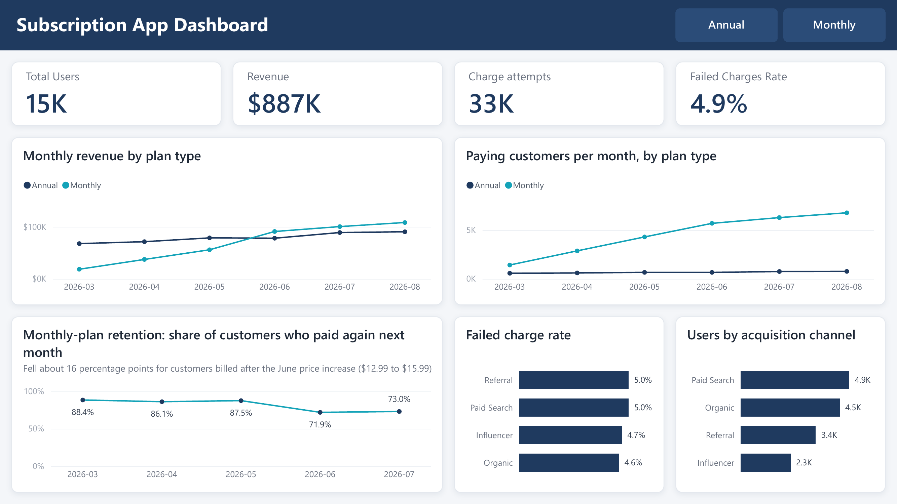
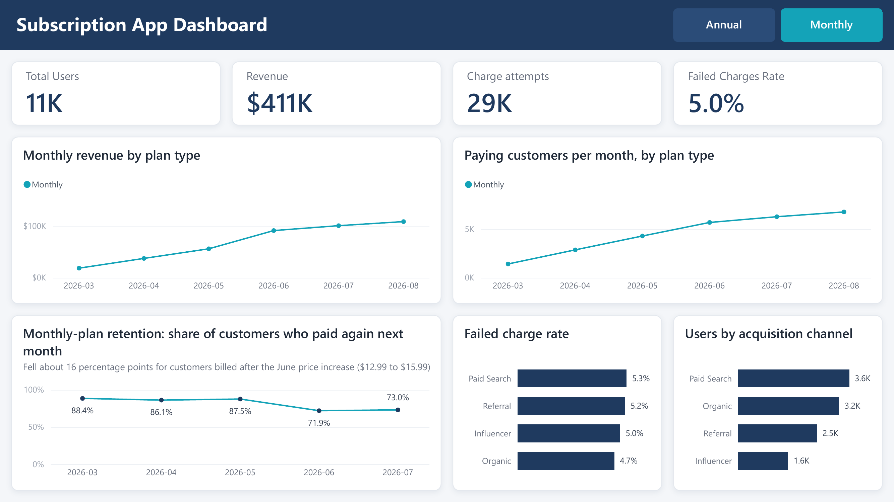

# Subscription App Dashboard (Power BI)

An interactive Power BI dashboard that tracks revenue, paying customers, failed charges and retention for a subscription app, with a focus on what happened when the monthly plan price went up in June.

It is the visual companion to my [SQL retention and pricing analysis](https://github.com/sheha61-boop/subscription-app-sql-analytics), which uses the same dataset.

## Preview

**All customers**



**Monthly plan only** (Plan Type slicer set to "monthly")



## Business question

Did the June price increase on the monthly plan ($12.99 to $15.99, up 23%) change how many customers kept paying, and where else might revenue be at risk?

## Key findings

All figures were checked against the raw CSV files.

- **Scale:** 15,000 users, 32,888 charge attempts and $886,675 of revenue from successful charges. 4.86% of charge attempts failed.
- **Revenue mix:** monthly-plan users are 72.6% of users (10,890) but produce 46.4% of revenue ($411.27K). Annual-plan users are 27.4% of users (4,110) and produce 53.6% ($475.40K).
- **Growth:** total revenue per month rose from about $86.0K in March to about $198.9K in August. Paying monthly-plan customers grew from 1,411 to 6,778 over the same period, and kept rising after June, but more slowly.
- **Retention drop:** monthly-plan retention was 88.4%, 86.1% and 87.5% for customers who paid in March, April and May. It fell to 71.9% for customers who paid in June (the first month at the new price) and was 73.0% for July. That is a drop of about 16 percentage points (87.5% to 71.9%), and it coincides with the price increase.
- **Failed charges by plan:** 5.04% of monthly-plan charge attempts failed, against 3.6% for annual. Monthly customers are charged every month, so they have more chances to fail.
- **Failed charges by channel:** rates are close across acquisition channels (4.6% to 5.0% overall; 4.7% to 5.3% within the monthly plan, highest for paid search). The gaps are small, so I would not treat any single channel as a clear problem.

## What the dashboard shows

One 1280 x 720 page with a navy header banner, four KPI cards and five charts.

| Visual | What it answers |
|---|---|
| Plan Type slicer (in the header) | Switches the page between annual and monthly. The retention chart is always limited to the monthly plan, so it stays on monthly (and shows nothing if "annual" is selected) |
| KPI cards | Total users, revenue, charge attempts and failed charge rate for the current selection |
| Monthly revenue by plan type | How revenue grew and how the two plans compare over time |
| Paying customers per month, by plan type | Whether paying-customer growth slowed after the price change |
| Monthly-plan retention | Share of customers who paid again the following month (March to July) |
| Failed charge rate (bar chart) | Where payment failures are slightly higher, by acquisition channel |
| Users by acquisition channel (bar chart) | Where customers come from |

## How it was built

- **Data:** four tables covering March to August 2026: `users` (15,000 rows), `charges` (32,888), `support_tickets` (3,068) and `usage_events` (467,720). The visuals use `users` and `charges`. The other two tables are loaded and related to `users`, ready for follow-up analysis.
- **Model:** `charges`, `support_tickets` and `usage_events` each have a many-to-one relationship to `users` on `user_id` (single direction), so selecting a plan or channel filters the related tables.
- **Design:** a custom navy and teal theme (included in `theme/`), with navy for the annual plan and teal for the monthly plan in the line charts.

Measures (all in the `charges` table):

```
Total Users = COUNTROWS(users)

Total Charges = COUNTROWS(charges)

Total Revenue = CALCULATE(SUM(charges[amount]), charges[status] = "succeeded")

Failed Charges Rate =
DIVIDE(
    CALCULATE(COUNTROWS(charges), charges[status] = "failed"),
    COUNTROWS(charges)
)

Paying Users =
CALCULATE(DISTINCTCOUNT(charges[user_id]), charges[status] = "succeeded")
```

Retention uses two helper columns on `charges` and one measure:

```
Period Number (column) =
VALUE(LEFT(charges[billing_period], 4)) * 12 + VALUE(RIGHT(charges[billing_period], 2))

Paid Next Month (column) =
VAR u = charges[user_id]
VAR nextP = charges[Period Number] + 1
RETURN
IF(
    CALCULATE(
        COUNTROWS(charges),
        ALL(charges),
        charges[user_id] = u,
        charges[Period Number] = nextP,
        charges[status] = "succeeded"
    ) > 0,
    1, 0
)

Retention Rate =
VAR lastPeriod = CALCULATE(MAX(charges[Period Number]), ALL(charges))
RETURN
DIVIDE(
    CALCULATE(SUM(charges[Paid Next Month]),
              charges[status] = "succeeded", charges[Period Number] < lastPeriod),
    CALCULATE(COUNTROWS(charges),
              charges[status] = "succeeded", charges[Period Number] < lastPeriod)
)
```

## Definitions

- **Revenue:** sum of successful charges only.
- **Charge attempts:** all charge records, whether they succeeded or failed.
- **Failed charge rate:** failed charge attempts divided by all charge attempts.
- **Paying users:** distinct customers with at least one successful charge in the month.
- **Retention:** customers who paid in month X and also paid in month X+1, divided by customers who paid in month X. The June point means June payers who paid again in July.

## Caveats

- **Correlation, not proof.** The retention drop coincides with the price increase, but this is not an experiment. The group of paying customers also grows quickly (from 1,411 in March to 6,285 in July), so newer customers make up a growing share of each month's base, and other factors such as tenure or seasonality could contribute.
- **Latest month is blank.** Retention for August cannot be calculated because there is no September data.
- **Short window.** Six months of data is enough to see the shift but not to judge long-term recovery. July's 73.0% is only a small uptick.
- **Small channel differences.** Failed-charge rates differ by less than one percentage point between channels.

## Possible next steps

- Compare retention by signup month (cohorts) to separate the price effect from customer mix.
- Use the support-ticket table (categories include billing complaints and cancellation requests) and the usage-events table to see whether unhappy or inactive customers drive the drop.
- Test a price change with a controlled experiment before drawing causal conclusions.

## Files

- `subscription_dashboard_v2.pbix`: the Power BI file (open it with Power BI Desktop, which is free)
- `images/`: dashboard previews (PNG)
- `dashboard_all.pdf` and `dashboard_monthly.pdf`: PDF exports of the page for all customers and for the monthly plan
- `theme/Subscription_Dashboard_Theme.json`: the navy and teal theme used for the report

## Tools

Power BI Desktop, DAX, data modeling.
